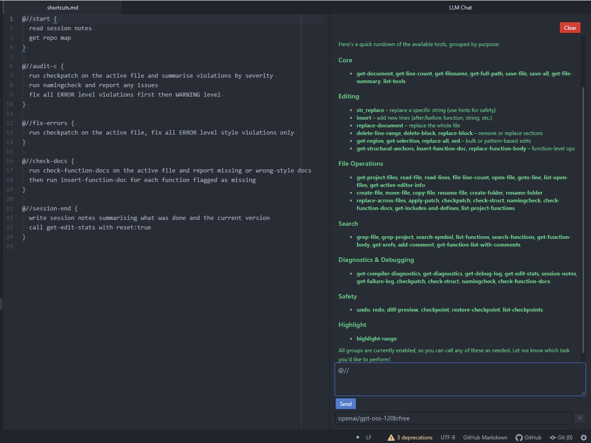
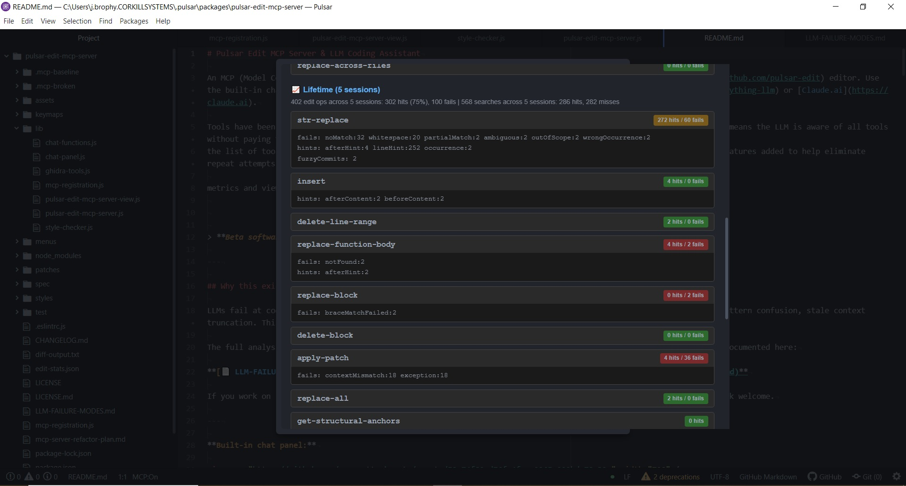
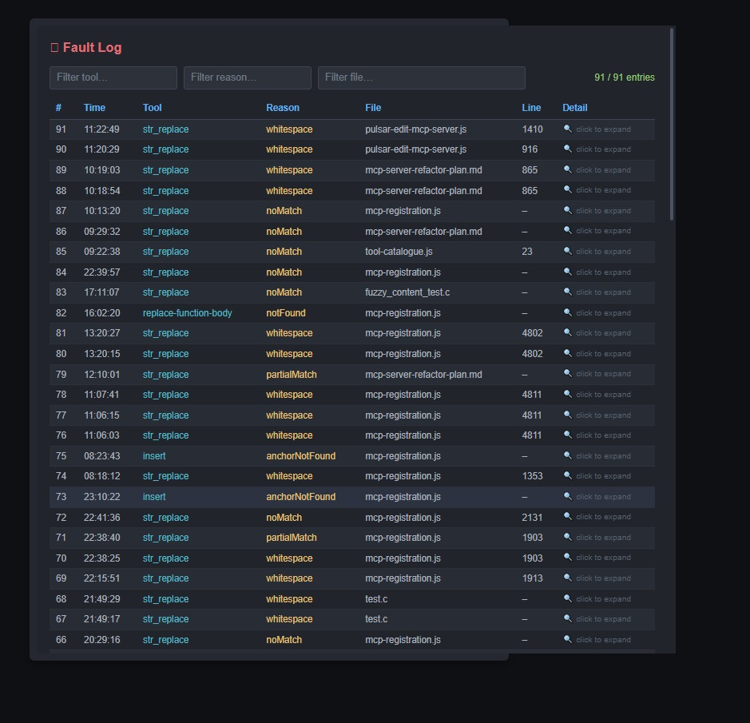
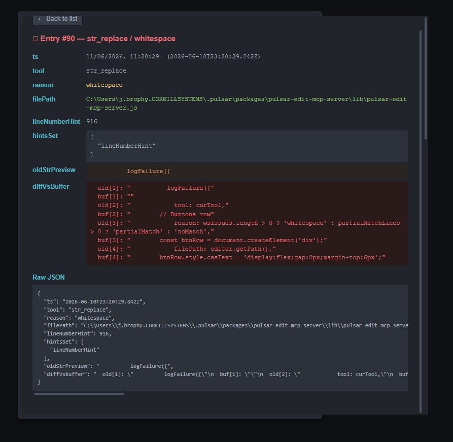

# Pulsar Edit MCP Server & LLM Coding Assistant

An MCP (Model Context Protocol) server and built-in chat panel that let an LLM read and edit code in the [Pulsar](https://github.com/pulsar-edit) editor. Use the built-in chat panel or any MCP client, for example [AnythingLLM](https://github.com/Mintplex-Labs/anything-llm) or [Claude.ai](https://claude.ai).

The tools came from Ghidra, Cline and Claude Code workflows and were extended with failure diagnosis, edit statistics and persistent notes. Every feature answers an LLM edit failure that was measured, not guessed at; the analysis is in [LLM-FAILURE-MODES.md](LLM-FAILURE-MODES.md).

> **Beta software**  --  tested but not production-hardened. Bug reports and suggestions are welcome.

## Status (version 0.25.0)

| | |
|---|---|
| Tools | 53 in the tool catalogue (34 on by default, 19 in groups that are off by default), plus `run-command`, `enable-group`, `get-repo-map`, `close-file`, `goto-focus`, `get-project-paths` and `add-project-path`, which are always available |
| Off by default | `checkpoints`, `debugging`, `ghidra`, `kernelChecks`, `fileAdmin` (turn one on with `enable-group`, no restart needed) |
| Tool definitions | about 43,000 JSON characters served by `tools/list` (measured 2026-11-19, down from about 63,000 on 2026-11-18) |
| Source | `lib/` has 52 modules; `lib/mcp-registration.js` is about 6,000 lines and holds the handlers |
| Tests | 68 test files, 5,926 checks, 0 failing (`npm test`, or `node test/check.js` before restarting Pulsar) |
| Open work | [TODO.md](TODO.md) (the XW items from the Xbox adapter field test, R-items, H-items) |
| History | [CHANGELOG.md](CHANGELOG.md) |

Recent changes worth knowing about (details in the CHANGELOG):

- `replace` takes `edits:[{old_str,new_str},...]` for several literal edits in one all-or-nothing step, with `dryRun` and `backup:true`.
- Whole-line `replace`, `apply-patch` and end-of-file `insert` keep each line's own LF or CRLF ending, in files with mixed endings too.
- `apply-patch` was fixed and live-tested: fuzzy rescue, `confirm:true`, and a refusal if the file changed since the preview.
- Edit tools no longer take regex; use `sed`. `grep-file` and `grep-project` use POSIX regex like plain `grep`.
- `get-repo-map`, `replace-across-files`, `grep-project` and `get-project-files` are scoped to one project (the one holding the active file, or `project:"name"`), and stay inside their budgets.
- `session-notes` is stored one file per project folder.

## What makes this different

Most MCP servers expose editor actions and stop there. This one treats LLM edit failures as a first-class problem.

- **Content-anchored editing.** `inFunction`, `afterString`/`beforeString`, `afterFunction`/`beforeFunction`, `afterSymbol`/`beforeSymbol`, `betweenHint`, `banner`, `ifdefBlock` and `occurrence:N` find the place by content, so edits do not drift when lines move. `afterLine`/`beforeLine` are search windows, not positions: the text must still match inside them.
- **It refuses instead of guessing.** An ambiguous match, a hit glued to a longer identifier, a match only found outside the narrowed scope, a trailing-comment mismatch and a regex given to an edit tool are all refused with nothing written, and the response says why.
- **Failures name their cause.** A miss reports whitespace or Unicode differences line by line, how many lines matched before it diverged, a similarity score, the closest area, and where the text exists if it is elsewhere. A mid-line `old_str` given to a whole-line edit is named as that, with the two ways to fix it.
- **Cheap corrections.** After a failed `replace`, resend just `{ filePath, old_str }` and the server merges it into the failed call. After an `insert` preview, send `{ filePath, commitLastPreview:true }`.
- **Rescue where it is safe.** One automatic retry for indentation and Unicode differences inside the narrowed scope; two candidates mean refusal. `fuzzyWhitespace` and `fuzzyContent` can also be asked for explicitly.
- **Every edit is checked afterwards.** A structure check (braces, block comments, `#if`/`#endif`) reports damage introduced by this edit only; `.c`/`.h` edits get a kernel style check; linter diagnostics are appended for the lines touched. The commit step re-verifies the exact text in the live buffer before writing, and edits are saved.
- **The model can read its own failure data.** `get-edit-stats` (per tool and per reason) and `get-failure-log` (structured fault records) let the agent change strategy mid-session.
- **Persistent project memory.** `session-notes` carries lessons between sessions, one file per project.
- **Edits never touch your active tab.** Every edit tool works on a `filePath`; closed files are edited through a buffer with full undo and no tab.

Screenshots:


**AnythingLLM external client:**


**Shortcut use:**



**Stats panel:**



**Fault Log:**



**Fault Log Entry:**



---

## Installation

```sh
ppm install https://github.com/professor-jonny/pulsar-edit-mcp-server
```

Start the server with **Packages → MCP Server → Listen**, or turn on **Auto-Start**. A **`MCP:On`** tile appears in the bottom-left status bar while it runs; click it to toggle the server.

### Settings

| Setting | Default | Description |
|---|---|---|
| MCP Server Port | `3000` | Port the server listens on |
| OpenAI API Endpoint | `https://api.openai.com` | Base URL for the built-in chat (everything before `/v1/chat/completions`). Needs a restart |
| API Key | _(empty)_ | API key for the built-in chat |
| Auto-Start MCP Server | `false` | Start the server when Pulsar opens |
| Focus Edited File | `true` | After an LLM edit, bring the edited file's tab to the front. Closed files are always edited silently. Toggle with **Packages → MCP Server → Toggle Focus Edited File** |
| Max Tokens | `4096` | Maximum tokens for built-in chat replies |
| Show Chat Panel on Startup | `true` | Open the built-in chat panel when Pulsar launches |
| Sound and Taskbar Flash for Destructive-Command Approval | `true` | Chime and flash when `run-command` is waiting for your click on Run |
| Tool Groups | see below | Turn tool groups on or off to control token use |

### External client configuration

```json
{
  "mcpServers": {
    "pulsar-edit-mcp-server": {
      "url": "http://localhost:3000/mcp",
      "disabled": false,
      "alwaysAllow": [],
      "type": "streamable"
    }
  }
}
```

MCP sessions live in memory. After a Pulsar restart or package reload the server answers an old session id with `404` / JSON-RPC `-32001` "Session not found" so the client re-initialises; expect the first one or two calls after a reload to fail with a connector error, then retry.

---

## Tool groups

Disabling a group in **Settings → Tool Groups** takes effect when the client reconnects. `enable-group` turns a group on at runtime without a restart. Counts are from the live tool catalogue.

### Core (6, always on)

| Tool | Description |
|---|---|
| `get-file-summary` | Structure of a file: functions, includes, defines, TODOs |
| `save-all` | Save all modified editor tabs |
| `list-tools` | Every tool with its group and enabled state |
| `get-edit-stats` | Per-tool hits, failure reasons, hint usage. Compact by default (current session only, zero counters left out); `scope:'lifetime'` or `'both'`, `tool:'name'`, `full:true`, `reset:true` |
| `session-notes` | Persistent notes, one file per project (see [Session notes](#session-notes-and-edit-stats)) |
| `get-failure-log` | Query the structured fault log by `tool`, `reason`, `filePath`, `tail` |

`enable-group` is also always available.

### Edit (12)

| Tool | Description |
|---|---|
| `replace` | The default edit tool. `old_str` matches whole lines; `fragment:true` replaces just a part of a line or a multi-line span (hits glued to a longer identifier are refused unless `guardIdentifier:false`). Scope hints, `occurrence:N`, `fuzzyWhitespace`, `fuzzyContent`, `dryRun`. `edits:[{old_str,new_str}]` applies several literal edits together: one undo step, all or nothing, each must match exactly once, `dryRun` checks the whole set, `backup:true` copies the file to TEMP first. A whole-line replace keeps each line's LF or CRLF |
| `insert` | Insert lines by anchor (`afterFunction`/`beforeFunction`, `afterString`/`beforeString`, `afterSymbol`/`beforeSymbol`, `betweenHint`, `banner`, `ifdefBlock`, `afterContent`/`beforeContent`), or `endOfFile`/`startOfFile`. Positional `afterLine`/`beforeLine`/`onLine` (with `expectedContent`) drift after other edits. `dryRun`, then `commitLastPreview:true` |
| `delete` | Delete by content in six modes: `banner`, `ifdefBlock`, `inFunction`, `startContent`+`endContent`, `matchString` (`fragment:true` removes only the span), `startLine`+`endLine` (with `expectedContent`). Delete uses strict matching, no automatic rescue. Ambiguous anchors are refused with the candidate lines |
| `replace-all` | Replace every occurrence of a literal string in one file; `dryRun` shows the count and places |
| `sed` | GNU sed 4.9 scripts on one file, run by our own implementation (BRE, or ERE with `extended:true`, `s///` flags, addresses, `{ }`, hold space, `a`/`i`/`c`). Scope hints restrict the script to a region. `w W r R e` are refused |
| `replace-function-body` | Replace a named function's signature and body in one step; the function is found by the name in the first line of `newBody` |
| `apply-patch` | Apply a unified diff to one file. Previews by default (`dryRun:true`). A failing hunk is retried with fuzzy, indent-aware matching and shown corrected; `confirm:true` applies the rescued version. For diffs from outside (for example `git diff`), not ones the model writes itself |
| `write-file` | Write a whole file (`text`); a new path is created and opened, an existing file needs `overwrite:true` and goes through the buffer (undo works) |
| `read` | Read a section of any file without opening it, by the same anchors as the edit tools, or `startLine`/`endLine`, or `centerLine`/`nearLine` + `radius`. Ambiguous anchors are refused |
| `get-structural-anchors` | List section banners and `#ifdef` names to use as anchors |
| `get-selection` | The selected text and its range |
| `insert-function-doc` | Insert a kernel-doc skeleton above a function (kernel `.c`/`.h` only) |

### File operations (4)

| Tool | Description |
|---|---|
| `get-project-files` | List files under a project, optionally by glob |
| `list-project-functions` | Every function definition with line numbers |
| `file-line-count` | A file's line count without loading it |
| `replace-across-files` | Literal find and replace across project files. The first call previews; `confirm:true` commits. Edits go through buffers (undo kept) and each file is saved; a failed save is reported as `NOT SAVED` or `PARTLY SAVED` |

Also always available: `get-repo-map` (see Search), `get-project-paths`, `add-project-path`, and `run-command` (see [Command Output panel](#command-output-panel)).

### File admin (5, off by default)

`move-file`, `copy-file`, `create-folder`, `rename-folder` (open tabs are retargeted, undo history kept) and `get-includes-and-defines`.

### Navigation (4)

`open-file`, `goto-line`, `list-open-files`, `get-file-info` (name, path, line count; for an open file also language, cursor and modified state). Also available: `close-file` and `goto-focus`.

### Search (2)

| Tool | Description |
|---|---|
| `grep-file` | Search one file. `contextLines`, `occurrence:N`, `wordRegexp`, `lineRegexp`, `invertMatch`, `onlyMatching`, `countOnly`. Buffer-first, so unsaved edits are seen |
| `grep-project` | Search the project; same options, plus `project:"name"` scoping |

`regex:true` is POSIX like `grep` (basic syntax; `extended:true` for `grep -E`), not JavaScript: `\d` is the letter d, `*?` is greedy, and a bare `| + ? ( ) { }` is literal in a basic regex. Matching is case-sensitive like `grep`; `caseSensitive:false` is `grep -i`, and a case-sensitive miss is re-run once ignoring case and reported. Without `regex:true` the query is a plain literal.

`get-repo-map` gives an Aider-style compressed index: symbols from tree-sitter (or regex for closed files), ranked by cross-file references, kept inside `maxTokens`, scoped to one project. It flags files with `[unicode]`, `[mojibake xN]` and `[crlf xN]`. Use it first on an unfamiliar project.

### Safety (2) and checkpoints (4, off by default)

`undo` and `redo` are on by default. `checkpoint`, `restore-checkpoint`, `list-checkpoints` and `diff-preview` are in the `checkpoints` group; checkpoints are in memory and are cleared when the server restarts (saving server source files restarts it).

### Diagnostics (3)

| Tool | Description |
|---|---|
| `get-diagnostics` | Live linter diagnostics from linter-bundle, no save needed |
| `get-compiler-diagnostics` | Syntax check of the saved C/C++ file with gcc, clang or cl |
| `check-struct` | Absolute brace, block-comment and `#if` balance of a file |

### Kernel checks (3, off by default)

`checkpatch` (kernel style audit of a whole file), `namingcheck` (verb-tier names, camelCase, macro case) and `check-function-docs` (missing or wrong-style kernel-doc comments). With `insert-function-doc` these are for Linux-kernel-style C only.

### Debugging (1, off by default) and highlight (1)

`get-debug-log` returns recent tool-call log entries (`tail`, `filter`, `clear`). `highlight-range` highlights a line range in the editor.

### Ghidra (6, off by default)

Tools for Ghidra-exported C: `list-functions`, `search-functions`, `get-function-body`, `get-xrefs`, `add-comment`, `get-function-list-with-comments`. Ghidra's decompiler output is pseudocode and not always valid C, so these pair with a real compiler (`gcc`/`clang`) and with `replace-function-body` for cleaning up decompiled functions one at a time.

---

## How edits behave

**Matching.** The shared engine (`lib/match-engine.js`) resolves the scope hints to one search window, matches inside it, re-verifies the target rows in the live buffer immediately before writing, and builds the response. Matching is tolerant of CR/LF differences, and new text takes the line ending of the text it replaces.

**Ambiguity.** More than one match with no scope hint is refused with every line number listed. An explicit `occurrence:N` is a deliberate choice and disables the guard; an N beyond the number of matches is refused, never clamped. `old_str:"count"` does not match inside `discount`, and a needle that appears twice on one line counts as two occurrences.

**Failure responses.** The first failure already explains why: whitespace or encoding differences, a partial match, a comment mismatch, text found outside the scope or elsewhere in the file, a similarity score, and the closest area. After repeated failures the response suggests a different tool. On a successful unhinted edit in a file over 300 lines it suggests a hint for next time.

**Failure log.** Every failed edit is written to `session/session-faults.ndjson` with the active hints, a diff against the closest buffer area, a preview and the proposed text. Hint failures are logged as `hintFault:<hint>:<variant>`. Read it with `get-failure-log` or **MCP: Show Fault Log...**.

**Response format.** Every edit returns the same shape, built in `lib/edit-response.js`:

```
✅ replace — line 42, +3 lines [fuzzyWhitespace]
🎨 style: [L2] wrong indentation
⚠️ struct: unmatched opening brace (net +1 { })
```

The warning lines are silent when clean.

**Lint and style.** Linter feedback is always on (the old `lint` parameter is accepted and ignored). It covers the rows the edit touched, plus or minus a few lines; `apply-patch`, `replace-all` and `sed` use the whole file but report only what the edit changed. For `.c`/`.h` files the kernel style checker runs on the added or changed lines only; `checkpatch` audits a whole file on demand. The inline and on-demand counters are separate in `get-edit-stats`.

**Unicode.** `fuzzyContent:true` compares after normalising smart quotes, dashes, non-breaking and zero-width spaces, and commits against the original text. `fuzzyWhitespace:true` ignores indentation when matching; `replace` also reindents the new text to the buffer's own whitespace.

**Buffers.** Edits go through the Pulsar buffer, so undo history is kept, and the file is saved after each edit. A file that is not open is edited through a background buffer with no tab. Preview any edit with `dryRun:true`.

**Mass edits.** `replace-across-files` can touch documentation or generated files if the scope is wide. Use `glob` and read the preview before `confirm:true`.

## Session notes and edit stats

These give the model memory across sessions. Suggested protocol (repeat it in your prompt or in `shortcuts.md`):

1. At the start call `session-notes({ action: "read" })`. With no `project` it reads the current project and lists the other projects that have notes; `project:"name"` reads one, `project:"all"` reads everything, `tail:N` limits it.
2. While working, if `replace` fails twice in a row call `get-edit-stats()` and read the failure class before retrying.
3. At the end call `session-notes({ action: "write", project: "<name>", note: "..." })` with what worked, what failed and what would have saved a retry. Counters are saved to `session/session-stats.json` automatically; only `reset:true` flushes the session into the lifetime totals.

Notes are NDJSON, one file per project folder, in `session/notes/`. `edit`, `delete` and `clear` need an explicit `project` and work by per-project `[index]`; deleting shifts later indexes down, so delete the highest index first. Keep one "current state" note updated in place rather than many parallel ones.

The stats panel (**Packages → MCP Server → Show Edit Stats...**) shows the same counters, grouped as Edit, Search, Nav / file, RE / Ghidra, Kernel and Shell tools. Dry runs are counted separately and never as hits.

## Chat panel

An LLM chat interface (when an API key is set) and a live display of tool activity from external clients. Open it with **Packages → MCP Server → Show Chat Panel** or `pulsar-edit-mcp-server:show-chat-panel`.

- **Model selector:** a searchable list fetched from the configured endpoint; the last model is remembered across restarts.
- **`@//` shortcuts:** type `@//` in the input to pick a named block from `shortcuts.md` in the project root; it expands into the input for editing. The file is re-read on every trigger, and created with samples if missing.
- Text is selectable and right-click offers Copy, Cut, Paste and Select All. Only text can be pasted, not images.

## Command Output panel

`run-command` runs a shell command (PowerShell on Windows, `/bin/sh` elsewhere) and returns stdout, stderr and the exit code. `cwd` defaults to the first project root; `"root:<rootFolderName>/<subpath>"` picks a root. `timeout` defaults to 30 seconds.

- **Before the command:** every open editor is checkpointed and modified buffers are saved so the shell sees current content. A buffer that cannot be saved does not stop the command; it is listed in `notSavedBeforeRun`.
- **Output** goes live to the Command Output panel (a dockable pane), not the chat. You can type into the running process's stdin there, or close stdin, for commands that wait for input. `showOutput:false` keeps a noisy command out of the panel; do not use that for anything that might prompt.
- **Destructive commands** (`rm`, `rmdir`, `del`, `rd`, `Remove-Item`, `format`, `git clean`, `git reset --hard` and similar) pause until you click **Run** in the panel; `confirm:true` does not skip it, and no answer within two minutes means the command is not run.
- **Open the panel** with **Packages → MCP Server → Show Command Output Panel** or `pulsar-edit-mcp-server:show-command-terminal-panel`.

> **Security warning:** `run-command` has unrestricted shell access. The destructive-command check is pattern-based and not exhaustive: commands that do damage indirectly (`patch`, `robocopy /purge`, output redirection, PowerShell scripts) are not caught, and it can match harmless commands that contain the words. If the panel cannot be opened a matching command is blocked. Run Pulsar in a sandboxed or virtual environment when this tool is on.

Known limits of `run-command` (tracked in TODO.md): no background mode yet, so a command over the timeout is killed; the pre-run save covers all open buffers, not only the project's; the approval wait is not reported clearly to the caller.

## Emergency revert

If an edit to the live server crashes it, restore a known-good copy. The baseline is not automatic: use **Packages → MCP Server → Save Backup** while the server is healthy (it copies the server files to `.mcp-baseline/`). To restore, press `Ctrl+Alt+Shift+R`, or right-click the editor → **MCP: Emergency Revert Server File...**, or use the Packages menu. The restore rewrites the file and restarts the HTTP server. If the package itself failed to load, try in order: **Restart Server**, **Reload Packages**, a full Pulsar restart, then restart the LLM client.

Saving files under `lib/` restarts the server, so use `node test/check.js` (syntax, load and tests) before restarting Pulsar.

## Source layout

`lib/mcp-registration.js` holds the tool handlers. Shared logic is in small modules, most of them pure (no Pulsar, no I/O) and each with its own test file:

| Area | Modules |
|---|---|
| Tool framework | `tool-framework.js` (buffer by `filePath`, `ctx.commit`, dry run, retry stash, failure counters), `tool-catalogue.js`, `schema.js`, `scope-arg.js`, `project-scope.js`, `regex-guard.js` |
| Matching | `match-engine.js`, `edit-match.js`, `fragment-match.js`, `identifier-boundary.js`, `mid-line-hint.js`, `recover.js`, `substring-lines.js` |
| Failure diagnosis | `fail-diagnostics.js`, `comment-diagnosis.js`, `outside-scope-diagnosis.js`, `tool-hints.js`, `retry-context.js` |
| Edit planners | `replace-fragment.js`, `replace-all-plan.js`, `multi-edit-plan.js`, `patch-rescue.js`, `patch-utils.js`, `write-plan.js`, `raf-commit.js` |
| sed and grep | `sed-parse.js`, `sed-run.js`, `sed-tool.js`, `posix-regex.js`, `search-engine.js` |
| Reading and maps | `read-page.js`, `read-response.js`, `repo-map.js`, `tree-sitter-symbols.js`, `buffer-helpers.js`, `mcp-ignore.js` |
| After the edit | `edit-response.js`, `struct-check.js`, `style-checker.js`, `naming-checker.js`, `lint-helpers.js` |
| State | `edit-stats.js`, `session-notes-store.js`, `preflight-save.js` |
| Interface | `pulsar-edit-mcp-server.js`, `chat-panel.js`, `chat-functions.js`, `command-terminal-panel.js`, `command-confirm.js`, `pulsar-edit-mcp-server-view.js` |

## Tests

A plain-Node suite with no framework. `npm test` (or `node test/run-all.js`) runs every `test/*.test.js` in its own process, prints one PASS or FAIL line per file and exits 1 on any failure; `node test/run-all.js <name-filter>` runs a subset. `node test/check.js` also checks syntax and that every module loads, and is the check to run before restarting Pulsar. A file passes only if it exits 0, prints no FAIL line and reports zero failed checks. Tests are named after the module they cover (`<module>.test.js` or `<module>.<topic>.test.js`); small related files were merged on 2026-11-19, so some files contain several blocks. Current: 68 files, 5,926 checks, 0 failing.

## Editing the repository's files (encoding)

The text files are UTF-8 without a BOM. On Windows do not edit them with PowerShell text cmdlets or redirection (`Get-Content`, `Set-Content`, `Out-File`, `>`): Windows PowerShell 5.1 reads BOM-less UTF-8 as the ANSI code page and garbles every non-ASCII character on write-back, and `Set-Content -Encoding UTF8` adds a BOM and CRLF. Use the package's own edit tools or a real editor, or in a script read and write with an explicit encoding (`[IO.File]::ReadAllText(path, [Text.UTF8Encoding]::new($false))`).
